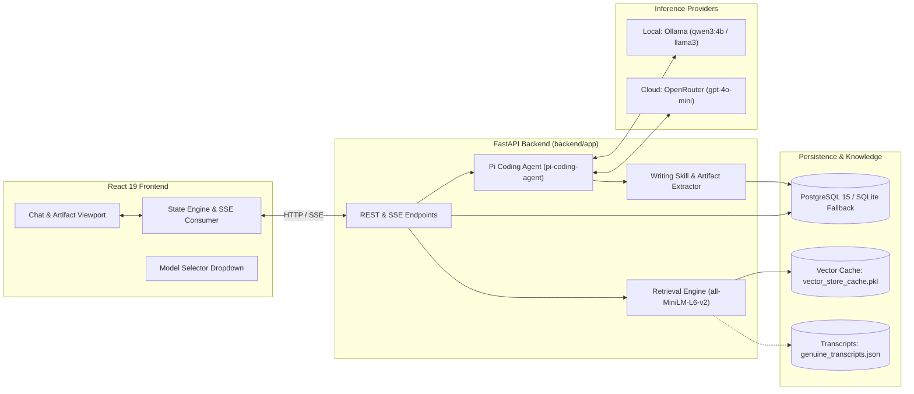

# 🎙️ The Lenny Growth Assistant

[](https://fastapi.tiangolo.com)
[](https://react.dev)
[](https://www.typescriptlang.org)
[](https://tailwindcss.com)
[](https://pypi.org/project/pi-coding-agent/)
[](https://github.com/pgvector/pgvector)
[](https://ollama.com)
[](https://openrouter.ai)
[](https://docs.pytest.org)
[](https://vitest.dev)
[](LICENSE)

An intelligent, full-stack AI conversational assistant designed to answer product management, startup growth, and strategy questions. Grounded entirely in insights from **Lenny Rachitsky's Podcast and Newsletter transcripts**, the assistant pairs semantic vector retrieval (RAG) with a specialized writing skill that crafts publication-ready **Ship 30 for 30** style essays (~1,250 words) and interactive HTML deliverables rendered in a sandboxed, side-by-side artifact viewer.

---

## 📑 Table of Contents
1. [Project Overview & Problem Solved](#1-project-overview--problem-solved)
2. [Target Users & Key Use Cases](#2-target-users--key-use-cases)
3. [Feature Highlights](#3-feature-highlights)
4. [Architecture & Request Flow](#4-architecture--request-flow)
5. [Technology Stack & Rationale](#5-technology-stack--rationale)
6. [Prerequisites](#6-prerequisites)
7. [Quickstart Setup Guide (Windows / macOS / Linux)](#7-quickstart-setup-guide-windows--macos--linux)
8. [Environment Variables Reference](#8-environment-variables-reference)
9. [LLM Configuration: Ollama & OpenRouter](#9-llm-configuration-ollama--openrouter)
10. [Database Setup & Migrations](#10-database-setup--migrations)
11. [Knowledge Base Ingestion & Refresh](#11-knowledge-base-ingestion--refresh)
12. [API Endpoints & Streaming Protocol](#12-api-endpoints--streaming-protocol)
13. [Using the Application](#13-using-the-application)
14. [Testing & Verification Status](#14-testing--verification-status)
15. [Troubleshooting Guide](#15-troubleshooting-guide)
16. [Security Posture & Isolation](#16-security-posture--isolation)
17. [Known Limitations & Future Improvements](#17-known-limitations--future-improvements)
18. [Documentation Index](#18-documentation-index)

---

## 1. Project Overview & Problem Solved

Lenny Rachitsky's archive comprises hundreds of hours of tactical interviews with world-class product leaders, growth practitioners, and founders. However, finding specific tactical frameworks is time-consuming, while general-purpose commercial LLMs frequently hallucinate advice and cannot cite timestamps or authentic transcripts.

**The Lenny Growth Assistant** solves this by:
- Semantically retrieving exact transcript passages with verifiable metadata (guest, episode title, timestamp, official URL).
- Providing complete offline independence via local Ollama models (`qwen3:4b`, `llama3:latest`), with instant switching to cloud models (OpenRouter) for high-reasoning tasks.
- Synthesizing complex topics into structured ~1,250-word atomic essays and HTML layouts delivered directly to a side-by-side artifact pane.

---

## 2. Target Users & Key Use Cases

- **Product Managers & Growth Engineers:** Query specific tactical problems (*"How did Airbnb find its first 1,000 hosts?"* or *"What are Elena Verna's best B2B PLG metrics?"*) and inspect verified citations.
- **Founders & Strategy Leaders:** Generate structured strategy essays and teardowns grounded in guest frameworks that can be downloaded or copied to clipboard.
- **Content Creators:** Draft Ship 30 for 30 style educational briefs backed by genuine expert quotes.

---

## 3. Feature Highlights

- **🧠 Grounded RAG with Relevance Filtering:** Queries are compared against 1,000-word transcript chunks using cosine similarity. Chunks below threshold (`< 0.18`) are discarded to prevent hallucinations.
- **⚡ Dual LLM Provider Switching:** Visible switcher in the UI between **Local (Qwen3)**, **Local (Llama 3)**, and **Cloud (OpenRouter)**.
- **📝 Dedicated Ship 30 for 30 Writing Skill:** Prompts requesting essays or guides trigger editorial rules targeting ~1,250 words with compelling hooks, structured subheadings, and actionable takeaways.
- **📄 Side-by-Side In-App Artifact Viewer:** Displays generated deliverables in formatted Markdown or sandboxed HTML, with Preview/Source tabs, Copy to Clipboard, and File Download.
- **🛡️ Strict HTML Security Isolation:** Generated HTML renders inside an iframe with **`sandbox=""`** and `referrerPolicy="no-referrer"`. Zero scripts, forms, or cross-origin access can execute.
- **🌊 Low-Latency SSE Streaming:** Server-Sent Events stream incremental tokens alongside status indicators (*"Thinking..."*, *"Generating your answer..."*, *"Drafting your artifact..."*).
- **💾 Relational Chat Persistence:** Independent conversation threads with auto-naming, renaming, deletion, and SQLite fallback for zero-friction evaluation.

---

## 4. Architecture & Request Flow



### Request Flow Walkthrough:
1. **User sends message:** Frontend dispatches `POST /api/v1/chat` with `stream: true` and active provider/model.
2. **Conversation & Message Stored:** Message is saved to the database.
3. **Semantic Retrieval:** `RetrievalService` embeds the query using `sentence-transformers/all-MiniLM-L6-v2` (384 dimensions) and searches `VectorStore`. Chunks with similarity `>= 0.18` are formatted into context. If no chunks qualify, an insufficient-evidence prompt is used.
4. **Agent Orchestration:** `pi_agent.agent.Agent` is instantiated with system grounding rules, conversation history, and retrieved context. It routes to `OllamaCompatibleProvider` or `OpenRouterProvider`.
5. **Streaming Output:** An SSE stream delivers `init` (citations), progressive `status` updates, and `text_delta` tokens.
6. **Artifact Extraction & Storage:** Upon completion, `extract_artifacts()` strips `<artifact>` tags from chat text, saves the artifact to the database, and emits the `done` event, automatically opening the Artifact Viewer.

---

## 5. Technology Stack & Rationale

| Layer | Technology | Rationale |
| :--- | :--- | :--- |
| **Backend Framework** | FastAPI 0.111.0 + Python 3.11 | High async performance, automatic OpenAPI documentation, clean SSE streaming. |
| **Agent Framework** | `pi-coding-agent` 0.6.0 | Evaluator-approved agent harness providing multi-provider abstraction (`Ollama` & `OpenRouter`) and ReAct tool binding. |
| **Database** | PostgreSQL 15 / SQLite Fallback | PostgreSQL provides relational integrity; automatic SQLite fallback allows evaluators to run the app instantly without Docker. |
| **Embeddings** | `sentence-transformers/all-MiniLM-L6-v2` | Lightweight (384 dims), runs on CPU with zero cloud latency or cost. |
| **Frontend Framework** | React 19 + Vite 8 + TanStack Router | Modern component architecture, ultra-fast HMR, file-based routing. |
| **Styling & UI** | Tailwind CSS v4 + Radix UI | Curated dark-theme tokens (`.prose-lenny`), accessible keyboard primitives, responsive layout. |

---

## 6. Prerequisites

To run this application locally, you will need:
- **Python 3.11+** installed and available in your PATH.
- **Node.js 18+** and `npm` installed.
- **[Ollama](https://ollama.com/)** installed on your host machine for local inference.
- *(Optional)* **Docker & Docker Compose** for PostgreSQL (if Docker is not installed, the app transparently uses the built-in SQLite fallback).
- *(Optional)* **OpenRouter API Key** if you wish to test Cloud Provider mode.

---

## 7. Quickstart Setup Guide (Windows / macOS / Linux)

### Step 1: Clone the Repository
```bash
git clone https://github.com/Nisxzn/lenny-s-chatbot.git
cd lenny-s-chatbot
```

### Step 2: Configure Environment Variables
Copy `.env.example` in root and backend:
```powershell
# Windows PowerShell
copy .env.example .env
copy backend\.env.example backend\.env
copy frontend\.env.example frontend\.env.local
```
*(On Linux/macOS, use `cp .env.example .env`, `cp backend/.env.example backend/.env`, and `cp frontend/.env.example frontend/.env.local`)*

### Step 3: Setup Local Ollama Model
Ensure Ollama is running (`ollama serve`), then pull the default model:
```bash
ollama pull qwen3:4b
# Or optionally:
ollama pull llama3:latest
```

### Step 4: Setup and Start the Backend
Open a terminal in `backend/`:
```powershell
# Windows PowerShell
cd backend
python -m venv venv
.\venv\Scripts\Activate.ps1
pip install -r requirements.txt

# Start backend server
uvicorn app.main:app --reload --port 8000
```
*(On Linux/macOS: `source venv/bin/activate` followed by `pip install -r requirements.txt` and `uvicorn app.main:app --reload --port 8000`)*

The backend will automatically index transcripts on startup. Verify at **http://localhost:8000/docs**.

### Step 5: Setup and Start the Frontend
Open a second terminal in `frontend/`:
```bash
cd frontend
npm install
npm run dev
```
Open **http://localhost:5173** in your browser.

---

## 8. Environment Variables Reference

| Variable | Required? | Default Value | Purpose / Safe Example |
| :--- | :---: | :--- | :--- |
| `ENVIRONMENT` | Optional | `development` | Environment mode (`development` or `production`). |
| `BACKEND_PORT` | Optional | `8000` | Port for the FastAPI HTTP server. |
| `BACKEND_CORS_ORIGINS` | Optional | `["http://localhost:3000","http://localhost:5173"]` | Allowed CORS origins for frontend. |
| `DEFAULT_LLM_PROVIDER` | Optional | `local` | Default provider on startup (`local` or `cloud`). |
| `OLLAMA_BASE_URL` | Optional | `http://localhost:11434` | Base URL for Ollama daemon. |
| `OLLAMA_MODEL_NAME` | Optional | `qwen3:4b` | Default Ollama model name (`qwen3:4b` or `llama3:latest`). |
| `OPENROUTER_API_KEY` | **Required for Cloud** | `your_openrouter_api_key_placeholder` | API Key from [OpenRouter](https://openrouter.ai). |
| `OPENROUTER_MODEL` | Optional | `openai/gpt-4o-mini` | Cloud model slug (or `meta-llama/llama-3.3-70b-instruct:free`). |
| `DATABASE_URL` | Optional | `postgresql+psycopg://...` | PostgreSQL connection string. Falls back to SQLite if unreachable. |
| `VITE_API_BASE_URL` | **Frontend** | `http://localhost:8000/api/v1` | Backend URL used by the React client. |

---

## 9. LLM Configuration: Ollama & OpenRouter

### 9.1 Local Inference via Ollama
The system is pre-configured to use **`qwen3:4b`** (or `llama3:latest`):
1. Verify Ollama is reachable: `curl http://localhost:11434/api/tags`
2. Ensure the model exists: `ollama list`
3. If missing: `ollama pull qwen3:4b`
4. **Tool Safety Detection:** `OllamaCompatibleProvider` checks if the model has tool calling templates. For models without tools (like `llama3:latest`), it omits tool payloads to prevent HTTP 400 errors and relies on XML prompt formatting.

### 9.2 Cloud Inference via OpenRouter
1. Get an API key from [OpenRouter](https://openrouter.ai).
2. Set `OPENROUTER_API_KEY=sk-or-v1-...` in `backend/.env`.
3. In the UI header, click the Model Selector and choose **Cloud (OpenRouter)**.
4. Default model is `openai/gpt-4o-mini`. You can also configure free models like `meta-llama/llama-3.3-70b-instruct:free` in `.env`.

---

## 10. Database Setup & Migrations

### Option 1: Automatic SQLite Fallback (Zero Setup)
If Docker or PostgreSQL is not running, the application logs a warning and initializes a local SQLite database (`backend/lenny_assistant.db`). All conversation, message, and artifact tables are created automatically.

### Option 2: PostgreSQL with pgvector via Docker
If Docker is installed:
```powershell
docker-compose up -d db
cd backend
.\venv\Scripts\Activate.ps1
alembic upgrade head
```

---

## 11. Knowledge Base Ingestion & Refresh

1. **Automatic Startup Ingestion:** Every time the backend boots, [`run_startup_ingestion()`](file:///w:/~Works/Oogway/lenny's%20chatbot/backend/app/services/startup.py) loads transcripts from `backend/data/transcripts/` into the vector store and caches them to `backend/data/vector_store_cache.pkl`.
2. **Manual Ingestion via REST API:**
   ```bash
   curl -X POST "http://localhost:8000/api/v1/knowledge/ingest" \
        -H "Content-Type: application/json" \
        -d '{"filepath": "data/transcripts/genuine_transcripts.json"}'
   ```
3. **Inspect Vector Store Status:**
   ```bash
   curl "http://localhost:8000/api/v1/knowledge/status"
   ```

---

## 12. API Endpoints & Streaming Protocol

### Key Endpoints:
- `POST /api/v1/chat` — Send message and receive JSON response with citations & artifacts.
- `GET /api/v1/chat/stream` — Stream response via Server-Sent Events (SSE).
- `GET /api/v1/conversations` — List conversation threads.
- `POST /api/v1/conversations` — Create a new thread.
- `GET /api/v1/conversations/{id}` — Get thread with messages & citations.
- `DELETE /api/v1/conversations/{id}` — Delete thread (cascades to messages & artifacts).
- `GET /api/v1/artifacts/{id}` — Retrieve generated artifact.

### Server-Sent Events Format:
```
data: {"type": "init", "conversationId": "UUID", "citations": [...]}
data: {"type": "status", "message": "Thinking..."}
data: {"type": "text_delta", "text": "Product"}
data: {"type": "text_delta", "text": "-market fit..."}
data: {"type": "done", "data": {"id": "UUID", "content": "...", "artifacts": [...]}}
data: [DONE]
```

---

## 13. Using the Application

### 13.1 Asking Grounded Questions & Inspecting Citations
Type any question into the message composer:
> *"What does Lenny say about finding product-market fit?"*
- The assistant answers with direct guest quotes (e.g., Brian Chesky, Elena Verna).
- Click the **Source Pill** at the bottom of the message to open the citation drawer with the exact episode URL, speaker, and transcript timestamp.

### 13.2 Insufficient Evidence Handling
Type a question outside Lenny's podcast topic:
> *"How do I bake sourdough bread?"*
- The assistant informs you that Lenny's podcast transcripts do not cover sourdough baking, and invites you to ask product growth questions instead.

### 13.3 Generating Ship 30 for 30 Essays & Artifacts
Type a prompt requesting an essay or guide:
> *"Write an essay on growth loops and retention based on Lenny's podcast."*
- The Writing Skill activates, generating a ~1,250-word atomic essay with a compelling headline, structured H2 headers, bulleted frameworks, and concrete takeaways.
- The **Artifact Viewer** automatically slides open on the right:
  - Toggle between **Preview** and **Source**.
  - Click **Copy** to copy to clipboard.
  - Click **Download** to save as `.md` or `.html`.

---

## 14. Testing & Verification Status

| Test Suite | Environment | Total Tests | Result | Verification Notes |
| :--- | :--- | :---: | :---: | :--- |
| **Backend Pytest** | Python 3.11 | 65 | **62 Passed, 3 Skipped** | Covers chat flow, RAG retrieval, citations, writing skill, and SSE format. 3 PostgreSQL tests skip cleanly when running against local SQLite fallback. |
| **Frontend Vitest** | Node 22 / Vite | 13 | **13 Passed (100%)** | Covers state machine, SSE streaming, routing, and thread management. |
| **ESLint & Prettier** | Node / TypeScript | Entire project | **0 Errors** | Clean syntax, formatting, and strict TypeScript types. |
| **Frontend Build** | Vite Production | Full bundle | **0 Errors** | Successfully generates production assets in `.output/public`. |

Run all tests locally:
```powershell
# Backend
cd backend && pytest -v

# Frontend
cd frontend && npm test
```

---

## 15. Troubleshooting Guide

| Issue | Root Cause | Solution |
| :--- | :--- | :--- |
| **`Model 'qwen3:4b' is not installed in Ollama`** | Model hasn't been pulled locally. | Run `ollama pull qwen3:4b` in your terminal. |
| **`OPENROUTER_API_KEY is not set`** | Cloud provider selected without key. | Add your key to `backend/.env` or switch to **Local (Qwen3)** in the UI header. |
| **`Database connection failed: Falling back to local SQLite`** | PostgreSQL/Docker is not running. | Normal behavior! Development automatically falls back to SQLite (`lenny_assistant.db`). |
| **Empty retrieval results (`No relevant context found`)** | Query does not match any podcast topic. | Normal grounding behavior. Ask about PMF, growth loops, onboarding, or specific guests. |
| **Streaming connection interrupted or CORS error** | Port mismatch or backend not running. | Ensure backend is on `http://localhost:8000` and `VITE_API_BASE_URL=http://localhost:8000/api/v1` in `frontend/.env.local`. |
| **Local model generation is slow** | CPU inference on large context. | Switch model to `qwen3:4b` (lightweight 4B parameters) or select Cloud (OpenRouter). |

---

## 16. Security Posture & Isolation

1. **HTML IFrame Isolation:** Untrusted model-generated HTML is rendered in `HtmlPreview.tsx` using `<iframe sandbox="" referrerPolicy="no-referrer" srcDoc={html} />`. This disables script execution, form submissions, popups, and parent storage access.
2. **Markdown XSS Protection:** `react-markdown` is configured without raw HTML injection.
3. **Path Traversal Guards:** Ingestion endpoints strictly validate that file paths resolve within `backend/data/transcripts/`.
4. **Credential Safety:** Secrets are never hardcoded or sent to client payloads. `.env.example` templates contain safe placeholders.

---

## 17. Known Limitations & Future Improvements

- **Sliding Window Chunking:** Currently uses 1,000-word fixed sliding windows; future iterations could adopt semantic chunking based on speaker turns.
- **Local Generation Speed on CPU:** Large essays (~1,250 words) on local Ollama take 20–40 seconds on standard CPUs; recommended to use GPU acceleration or cloud models for rapid testing.
- **Single-User Scope:** The application is architected for single-evaluator take-home review; production deployments would add JWT user authentication and multi-tenant database row-level security.

---

## 18. Documentation Index

Complete project specifications and audit reports are cataloged in `/docs`:
- **[Product Requirements Document (PRD)](./docs/specs/PRD.md)** — User personas, JTBD, metrics, and trade-offs.
- **[System Architecture](./docs/specs/architecture.md)** — In-depth component boundaries, Pi Agent design, and schemas.
- **[Frontend Design Specification](./specs/design.md)** — Dark theme tokens, layout states, and accessibility.
- **[Implementation Roadmap](./docs/specs/IMPLEMENTATION_PLAN.md)** — 9-phase roadmap and verification criteria.
- **[RAG Pipeline Architecture](./docs/specs/rag.md)** — Chunking, embeddings, and threshold filtering.
- **[Writing Skill & Essays](./docs/specs/writing-skill.md)** — Ship 30 for 30 essay framework (~1,250 words).
- **[Artifact Viewer UI](./docs/specs/artifact-viewer.md)** — Sandboxed iframe security and actions.
- **[Agent Framework Compliance Report](./docs/reports/agent-framework-compliance.md)** — Pi Agent harness evaluation.
- **[Complete Documentation Hub](./docs/README.md)** — Documentation index.

---

## 📄 License

This project is licensed under the [MIT License](LICENSE).
