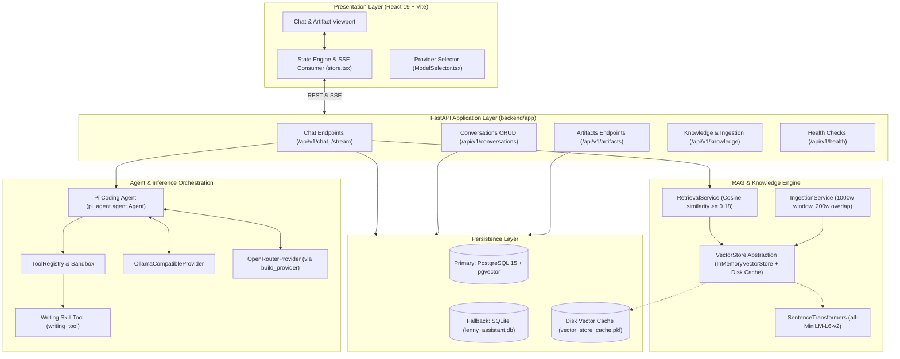
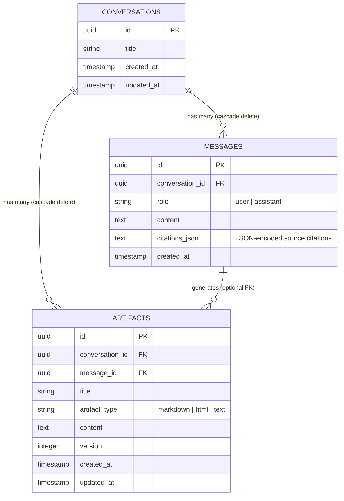
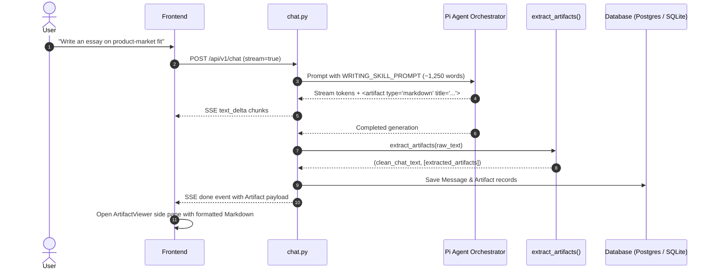

# System Architecture: The Lenny Growth Assistant

## 1. Architectural Overview & Component Boundaries

The Lenny Growth Assistant is built on a clean three-tier architecture designed for modularity, low-latency streaming, and strict local/cloud provider separation.

---

## 2. Component Details & Module Mapping

| Module Path | Role & Responsibilities |
| :--- | :--- |
| [`backend/app/main.py`](file:///w:/~Works/Oogway/lenny's%20chatbot/backend/app/main.py) | FastAPI app entrypoint, CORS configuration, lifespan handler with startup knowledge auto-ingestion. |
| [`backend/app/api/routes/chat.py`](file:///w:/~Works/Oogway/lenny's%20chatbot/backend/app/api/routes/chat.py) | Chat request pipeline: conversation init, RAG retrieval & relevance filtering, SSE streaming generator, artifact extraction, and DB persistence. |
| [`backend/app/services/llm.py`](file:///w:/~Works/Oogway/lenny's%20chatbot/backend/app/services/llm.py) | Multi-provider orchestration via `pi-coding-agent`. Wraps `OllamaCompatibleProvider` and OpenRouter cloud adapter with native tool capability checks. |
| [`backend/app/services/writing.py`](file:///w:/~Works/Oogway/lenny's%20chatbot/backend/app/services/writing.py) | Ship 30 for 30 writing prompt rules (~1,250 words), Pi Agent `writing_tool` registration, and resilient XML artifact parser (`extract_artifacts`). |
| [`backend/app/services/retrieval.py`](file:///w:/~Works/Oogway/lenny's%20chatbot/backend/app/services/retrieval.py) | Cosine similarity search, grounded context builder with source attribution, and representative chunk retrieval for broad overview queries. |
| [`backend/app/services/ingestion.py`](file:///w:/~Works/Oogway/lenny's%20chatbot/backend/app/services/ingestion.py) | Transcript JSON loader, text normalization, 1,000-word sliding window chunker, batch embedding generator. |
| [`backend/app/services/vector_store.py`](file:///w:/~Works/Oogway/lenny's%20chatbot/backend/app/services/vector_store.py) | Abstract `VectorStore` interface with `InMemoryVectorStore` implementation featuring disk cache persistence (`save_to_disk` / `load_from_disk`). |
| [`backend/app/db/session.py`](file:///w:/~Works/Oogway/lenny's%20chatbot/backend/app/db/session.py) | SQLAlchemy engine initialization with primary PostgreSQL connection and automatic development fallback to local SQLite. |

---

## 3. Database Schema & Persistence Model

The relational schema is managed with SQLAlchemy ORM and Alembic migrations:

### 3.1 Resilience & Fallback Protocol
- **Primary:** Connects to PostgreSQL using `DATABASE_URL` with connection health checks (`pool_pre_ping=True`).
- **Development Fallback:** If PostgreSQL is unreachable (e.g., Docker is not running), the engine logs a warning and automatically initializes `sqlite:///./lenny_assistant.db` with identical schema tables, ensuring tests and evaluation never fail due to database unavailability.
- **Production Safety:** When `ENVIRONMENT=production`, silent fallback to SQLite is strictly disallowed to prevent unintended data fragmentation.

---

## 4. Pi Coding Agent Integration & Tool Binding

The application leverages the **Pi Coding Agent (`pi-coding-agent`)** framework:
1. **Agent Setup:** Instantiates `pi_agent.agent.Agent` with `AgentConfig(system_prompt=...)` and a local sandboxed filesystem environment (`Sandbox(".")`).
2. **Tool Registry:** If the target model supports tool calling (e.g., cloud models or tool-enabled local models), `writing_tool` (`create_artifact`) is registered in `ToolRegistry`.
3. **Llama 3 / Qwen Tool Fallback:** Base models in Ollama (such as `llama3:latest`) lack OpenAI-compatible tool templates and return HTTP 400 when tool declarations are sent. `OllamaCompatibleProvider` inspects model capabilities via Ollama's `/api/show` or pattern checks; when native tools are unsupported, it strips the `tools` key from the payload and relies on system-prompt guided XML `<artifact>` output, which `extract_artifacts()` parses reliably.
4. **Cloud Execution:** OpenRouter cloud requests use `pi-coding-agent`'s `build_provider(provider="openrouter", model=model, api_key=api_key)`.

---

## 5. RAG Pipeline Architecture & Citation Provenance

### 5.1 Transcript Ingestion
- **Dataset:** Validated transcript files located in [`backend/data/transcripts/`](file:///w:/~Works/Oogway/lenny's%20chatbot/backend/data/transcripts) (`genuine_transcripts.json`, `sample.json`).
- **Chunking Strategy:** Sliding window chunker of **1,000 words** (~5,000 characters) with **200 words** (~1,000 characters) overlap. Preserves speaker, episode title, timestamp, and URL metadata on every chunk.
- **Embedding Model:** Local `sentence-transformers/all-MiniLM-L6-v2` producing **384-dimensional** dense vectors. Runs locally on CPU with zero cloud costs.
- **Startup Auto-Ingestion:** On FastAPI startup, [`run_startup_ingestion()`](file:///w:/~Works/Oogway/lenny's%20chatbot/backend/app/services/startup.py) checks if the vector store is populated. If empty, it attempts to load from `backend/data/vector_store_cache.pkl`, otherwise it indexes transcript JSONs and persists the cache.

### 5.2 Retrieval & Grounding Strategy
- **Relevance Thresholding:** Queries are embedded and compared against chunk vectors using cosine similarity. Only chunks with similarity **`>= 0.18`** are injected into the prompt.
- **Insufficient Evidence Handling:** When no chunks pass the threshold, the backend sends no context and explicitly instructs the model: *"No relevant evidence found in Lenny's Podcast transcripts."* The model informs the user and invites them to ask about covered guests.
- **Broad Podcast Summary Queries:** Detected via `is_podcast_summary_query()`. Bypasses narrow query search and retrieves diverse representative chunks across distinct episodes.
- **Citation Provenance:** Each retrieved chunk includes `episode_title`, `speaker`, `timestamp`, `url`, and excerpt text, formatted as a Pydantic `Citation` object.

---

## 6. Server-Sent Events (SSE) Streaming Protocol

The streaming endpoint (`/api/v1/chat?stream=true` or via request body `{"stream": true}`) yields standardized SSE events:

| Event Type | Payload Schema | Purpose |
| :--- | :--- | :--- |
| `init` | `{"type": "init", "conversationId": "UUID", "citations": [...]}` | Delivers conversation ID and retrieved citations before generation begins. |
| `status` | `{"type": "status", "message": "Thinking..."}` | Displays progressive user status ("Thinking...", "Generating...", "Drafting..."). |
| `text_delta` | `{"type": "text_delta", "text": "token"}` | Streams incremental response tokens to the UI. |
| `done` | `{"type": "done", "data": {"id": "UUID", "content": "...", "artifacts": [...], "citations": [...]}}` | Delivers finalized cleansed message and persisted artifact objects. |
| `[DONE]` | `data: [DONE]` | Standard SSE stream termination indicator. |
| `error` | `{"type": "error", "message": "..."}` | Delivers server-side errors (timeouts, rate limits) cleanly to the client. |

---

## 7. Writing Skill & Artifact Lifecycle

---

## 8. Security Architecture & Threat Model

1. **HTML/CSS Artifact Isolation:** Untrusted HTML generated by the LLM is rendered solely within an iframe with **`sandbox=""`** and `referrerPolicy="no-referrer"`. This disables script execution, prevents form submissions, disables popups, and blocks access to parent window cookies and storage.
2. **Markdown XSS Protection:** `react-markdown` is used without `rehype-raw`, meaning embedded `<script>` or raw HTML tags in Markdown are escaped and rendered as text.
3. **Path Traversal Protection:** The `/api/v1/knowledge/ingest` endpoint strictly validates that any requested file path resolves within `backend/data/transcripts/`.
4. **Credential Isolation:** The backend uses `pydantic-settings` with `.env` reading. No secrets are logged or exposed through client error responses.
